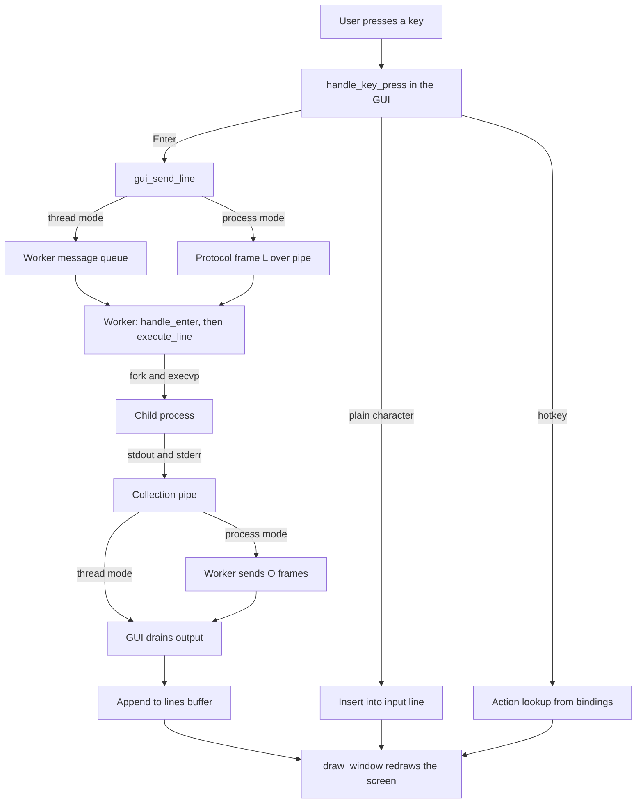
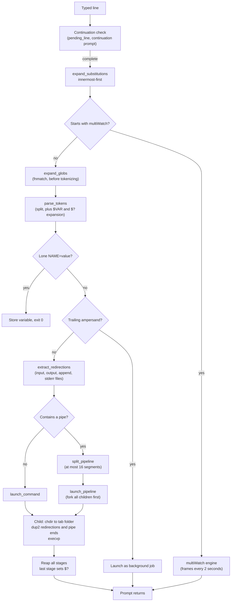
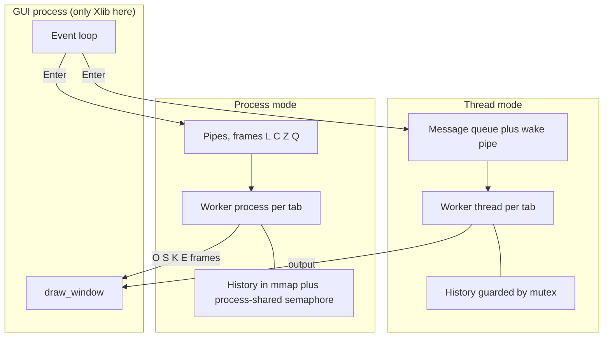
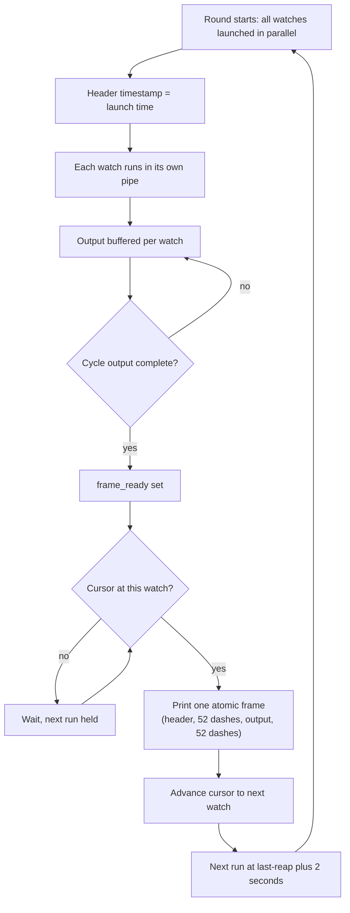
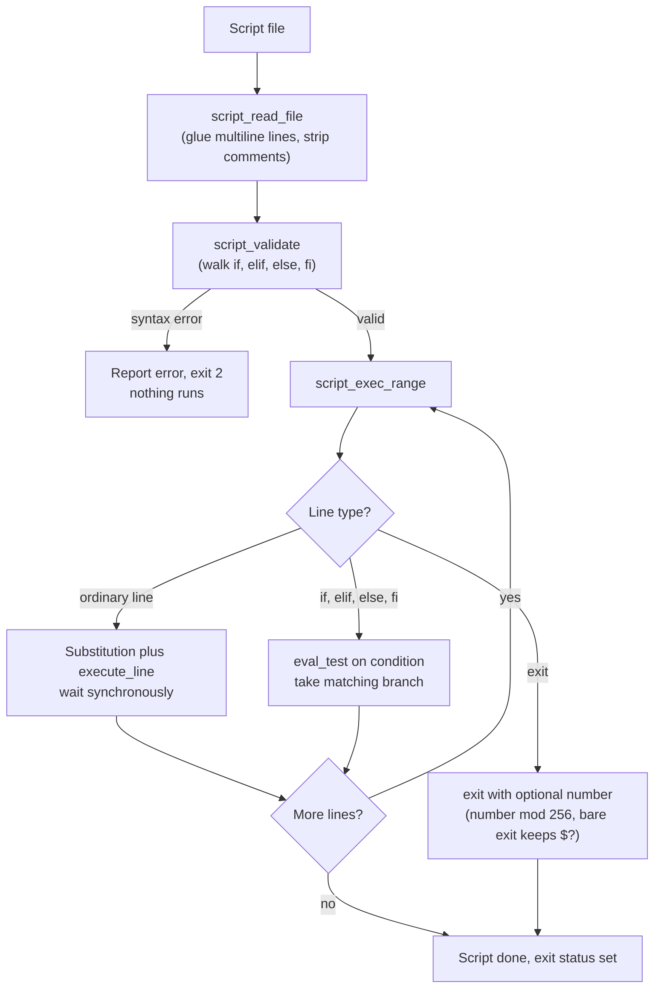

# Terminator — Design Document

Terminator is a terminal emulator plus a shell, written in C for Linux.
It opens one X11 window with multiple tabs. In each tab the user types
commands; Terminator parses them itself and runs them with `fork` +
`execvp`. It never hands commands to `/bin/bash`, never uses a PTY,
and never uses `system()` or `popen()`. Those are forbidden by the
project rules, and for a reason: a PTY plus bash would make the shell
someone else's program. Parsing the line, wiring pipes and
redirections, managing jobs, and interpreting scripts are the
assignment itself, so all of it is implemented here.

It runs in two modes, chosen at launch:

- **Thread mode** (default, `./terminator`): one process; each tab is
  a POSIX thread (`pthread`) running the shell engine.
- **Process mode** (`./terminator useProcess=True`): the GUI is the
  parent process; each tab is a separate forked child process running
  the shell engine, talking to the GUI over pipes.

The user-visible behaviour is identical in both modes. The difference
is only in how tabs are isolated and how history is shared.

The flowcharts in this document are written in Mermaid, which GitHub
renders as diagrams automatically when the file is viewed on
github.com.

## 1. File map

| File | Contents |
| --- | --- |
| `terminator.h` | Shared header: all includes, constants, struct types, global declarations (`extern`), and prototypes for every function. Every `.c` file includes it. |
| `task1.c` | Task 1: X11 window, tabs, drawing, the output buffer, tab open/close/switch, rendering and scrolling. |
| `task2.c` | Task 2: built-ins, external commands (`fork` + `execvp`), the `execute_line` dispatcher, exit-status (`$?`) handling. |
| `task3.c` | Task 3: multiline input, quoting, the tokenizer, `$VAR`/`$?` expansion, `$(...)` command substitution, glob expansion, Enter handling. |
| `task4.c` | Task 4: redirection (`<`, `>`, `>>`, `2>`). |
| `task5.c` | Task 5: pipelines of any length, plus the synchronous pipeline engine used inside `$(...)`. |
| `task6.c` | Task 6: multiWatch — several commands running in parallel, each re-run every 2 seconds, printed as atomic frames in list order. |
| `task7.c` | Task 7: hotkeys, the `~/.terminatorrc` binding file, input editing, history browsing, clipboard copy/paste, key dispatch. |
| `task8.c` | Task 8: signals and job control (Ctrl+C, Ctrl+Z, `&`, `jobs`, `fg`, `bg`). |
| `task9.c` | Task 9: the shared history store, `~/.terminator_history` persistence, Ctrl+R search. |
| `task10.c` | Task 10: Tab completion. |
| `task11.c` | Task 11: the bash script interpreter (`./script.sh`, `bash script.sh`, `source script.sh`). |
| `proj.c` | Main file: `main()`, the GUI event loop, every global variable's single definition, and the dual-mode engine (worker threads, forked workers, the GUI-worker protocol, dying-tab cleanup). |
| `Makefile` | Builds everything into `./terminator`. |
| `README.md` | Build and run instructions. |
| `DESIGN.md` | This document. |

The rule for splitting was: each function lives in the file of the
task that introduced it. A few functions grew across tasks (for
example `execute_line` started in Task 2 and now dispatches pipelines,
multiWatch, jobs and scripts too), but they stay where they were born
and call the later tasks' functions through the header. Functions are
global, not `static`, so that any task file can call any other task's
functions; `proj.c` holds the single definition of every global
variable, and the other files see them through the header's `extern`
declarations.

## 2. Architecture: three layers

```
  +--------------------+   X11 window, tabs, keyboard, mouse, clipboard
  |   GUI  (proj.c,    |   ONLY this layer calls Xlib. No other layer
  |   task1.c, task7.c)|   ever touches a Display, Window or GC.
  +--------------------+--------------------------+------------------+
  |   WORKER / ENGINE  |   One worker per tab. It owns the shell:
  |   (task2.c-11.c,   |   parsing, built-ins, fork/exec, pipes,
  |   part of proj.c)  |   redirection, jobs, watches, scripts.
  +--------------------+--------------------------+------------------+
  |   OPERATING SYSTEM |   fork, execvp, pipe, dup2, waitpid, kill,
  |   (Linux, POSIX)   |   select, pthread, mmap, semaphores.
  +--------------------+--------------------------+------------------+
```

The GUI layer never executes a command and never touches an engine
file descriptor. The engine layer never calls Xlib. This separation is
what makes both modes possible: in thread mode the worker is a thread
inside the same process, and in process mode the worker is a child
process — but in both cases the worker runs the same engine code and
talks to the GUI through a narrow interface (a message queue in
thread mode, a byte protocol over pipes in process mode).

Keeping the GUI out of execution also keeps the window responsive: a
long command cannot freeze redrawing or tab switching, and a crashed
command cannot take the window down with it. Only the GUI calls Xlib
because Xlib is not thread-safe by default, and letting workers draw
would corrupt the display connection.

## 3. Data structures

Almost everything about a tab lives in one struct, `TerminalTab`
(defined in `terminator.h`):

- **Input**: `input` (the current line being typed), `input_length`,
  `cursor` (where the text cursor sits inside the line),
  `saved_input`/`saved_valid` (the in-progress line stashed while
  browsing history with Up/Down, so Down past the newest entry
  restores it verbatim).
- **Output**: `lines` (the scrollback buffer, 500 lines) and
  `line_count`, `scroll_position` (mouse wheel, PageUp/PageDown).
- **Shell state**: `cwd` and `previous_cwd` (the tab's folder — note:
  the tab remembers its folder, the process itself never `chdir`s,
  so one tab's `cd` cannot move another tab), `last_exit_status`
  (the `$?` value), `pending_line`/`continuing` (a command still
  being typed across several lines, shown with the `"> "`
  continuation prompt).
- **Running commands**: `child_pid`, `pipe_pids`/`pipe_count`/
  `last_pid` (the foreground pipeline), `output_fd` (where the
  command's output is read from), `partial`/`partial_len` (an
  incomplete output line waiting for the rest).
- **Jobs and watches**: `jobs` (up to 16 background/stopped jobs),
  `fg_cmd`/`fg_pgid` (the foreground job), `watches`/`watch_count`/
  `watch_active` (the multiWatch set), `watch_cursor` (which watch's
  frame prints next, for list-order printing).
- **History/search/completion state**: `history_position`,
  `searching`/`search_stash`, `completing`/`compl_start`/`compl_len`/
  `compl_word`/`compl_matches`.
- **Script state**: `var_names`/`var_values`/`var_count` (script
  variables), `pos_args`/`pos_count` (`$0`–`$9`, `$#`), `script_sink`
  (where script output goes), `deferred` (lines typed while a script
  runs, played back afterwards).
- **Worker plumbing**: `worker_thread`/`worker_pid` (which worker
  this tab has), `proto_in_w`/`proto_out_fd` (process-mode pipe
  ends), `queue`/`q_head`/`q_tail`/`q_count`/`q_lock` (thread-mode
  message queue), `buffer_lock` (guards `lines`), `worker_dead`
  (set when a worker process exits, so the tab can print
  `--- this tab's process has exited ---` instead of crashing the
  window).

Other key structures:

- `Job`: one background or stopped job — an id, its process ids,
  its process group, its own output pipe, its command text, and its
  state (running in background, or stopped).
- `Watch`: one watched command in a multiWatch set — the command
  text, its pipe, its partial line buffer, its next run time, the
  launch timestamp of its current cycle (`launched_at`), the
  current cycle's buffered output (`cycle_out`/`cycle_len`/
  `cycle_cap`), and `frame_ready` (set when the cycle's output is
  complete and waiting for its turn to print).
- `Segment`: one stage of a pipeline — its argument vector, its
  argument count, and its redirections.
- `Redirection`: the four redirection slots of one command —
  `input_file`, `output_file`, `error_file`, and `append` (whether
  `>>` was used instead of `>`).
- `TabMsg`: one thread-mode message from GUI to worker — a type
  (`MSG_LINE`, `MSG_INTERRUPT`, `MSG_SUSPEND`, `MSG_QUIT`) and text.
- `SharedHistory`: the one history store shared by all tabs — a
  count and 10,000 slots of 1,024 characters, plus the lock (a
  `pthread_mutex_t` in thread mode, a process-shared `sem_t` in
  process mode).
- `Binding`: one hotkey row — a keysym, a modifier mask, and an
  `Action` enum value.

## 4. Life of a keypress

Thread mode and process mode differ only in how the keypress travels;
the shell work is the same.

**Thread mode:**

1. The GUI event loop (`main` in `proj.c`) reads an X11 `KeyPress`
   event with `XNextEvent`.
2. `handle_key_press` (`task7.c`) decides what the key means. Plain
   characters are inserted into `tab->input` at `tab->cursor`. A
   bound hotkey becomes an `Action` (`find_action` masks the
   modifier state down to Ctrl/Shift/Alt only, so NumLock and
   CapsLock cannot break a binding, and folds an uppercase letter
   to lowercase when a modifier is held).
3. If the key is Enter, the GUI does not execute anything itself. It
   sends a `MSG_LINE` message into the tab worker's queue
   (`gui_send_line`) and pokes the worker's wake pipe.
4. The worker thread (`shell_worker_main`) wakes, pops the message,
   and runs `handle_enter` → `execute_line` (Section 5).
5. Output comes back through the tab's output pipe. The worker pokes
   the GUI's wake pipe; the GUI drains the output into the tab's
   `lines` buffer and redraws the window (`draw_window`).

**Process mode:** steps 1–2 are identical, except the GUI writes a
protocol frame onto the worker's pipe instead of a message queue:
the letter `L`, a length, and the line text. Interrupt is `C`,
suspend is `Z`, quit is `Q`. The worker replies with frames of its
own: `O` for an output line, `S` for state (`cwd` + whether a
continuation is open), `K` for clear screen, `E` for "this tab
wants to close". The GUI's `drain_proto` reads those frames and
updates the tab. If the worker's pipe hits EOF, the GUI marks the
tab `worker_dead` and prints the "process has exited" line — the
other tabs keep working. That crash isolation is the whole point of
process mode, and it is demonstrated by killing a worker pid and
watching only its tab die.

**Flowchart — how a keypress becomes output:**



**Mouse input.** A mouse wheel notch arrives as a `ButtonPress`
event with button 4 (up) or 5 (down). Over the output area it moves
`scroll_position` by 3 lines per notch (Section 11); over the tab
bar it does nothing. Tab clicks are accepted only from button 1
(left click), so a wheel notch over the tab bar can never switch
tabs by accident. No new event mask is needed: `ButtonPressMask` is
already selected, and since no release mask is selected, one notch
delivers exactly one press.

**Why the GUI never executes commands.** If the GUI ran commands
itself, a long command would freeze the window (no redraw, no tab
switching) and a crashed command could take the window down.
Workers isolate execution from display. This is also why only the
GUI calls Xlib: Xlib is not thread-safe by default, and letting
workers draw would corrupt the display connection.

## 5. Life of a command

When a worker executes one typed line, the journey is:

1. **Continuation check** (`handle_enter`, `task3.c`). If the
   previous line ended with a backslash outside quotes, or a quote
   is still open, the new text is glued onto `pending_line` and the
   worker waits for more input, showing the `"> "` prompt. Inside
   double quotes a backslash-newline keeps the newline; outside
   quotes it glues the lines directly together.
2. **Substitution** (`expand_substitutions`, `task3.c`). `$(...)`
   and backticks are expanded innermost-first: the inner command is
   run (via `run_and_capture`) and its output, with trailing
   newlines stripped, replaces the `$(...)` text. The scan repeats
   (at most 10 passes) so nested substitutions resolve. A
   substitution inside single quotes is left alone.
3. **multiWatch check** (`execute_line`, `task2.c`). A line starting
   with `multiWatch` is diverted to the multiWatch engine before
   normal tokenizing (Section 8).
4. **Glob expansion** (`expand_globs`, `task3.c`). Pathname
   expansion runs on the substituted line, before tokenizing,
   because tokenizing destroys quote information (Section 12).
5. **Tokenize** (`parse_tokens`, `task3.c`). A state machine walks
   the line in four states: normal, single-quoted, double-quoted,
   and backtick. It splits on blanks, keeps quoted text together,
   keeps an empty `""` as a real empty token, and emits `|` and
   `&` as their own tokens even when glued to neighbours
   (`ls|wc` works). While tokenizing, `$?`, `$VAR` and `${VAR}`
   are expanded — but only in normal and double-quoted states.
   Single quotes shield everything.
6. **Assignment check** (`execute_line`, `task2.c`). A lone
   `NAME=value` word is stored as a variable instead of being run
   as a command. This is also how scripts set variables.
7. **Background marker.** A trailing `&` launches the command as a
   background job (Section 7). A `&` in the middle of a line is a
   syntax error (`$?` = 2).
8. **Redirection extraction** (`extract_redirections`, `task4.c`).
   `<`, `>`, `>>`, `2>` — standalone or glued to a filename, like
   `>out.txt` — are pulled out of the argument list into a
   `Redirection` struct. The last operator of each kind wins. A
   dangling operator (`echo >` with no file) is a syntax error:
   nothing runs and `$?` becomes 2. A word like `a>b` stays a word.
   Note the token rule: a redirect operator must *start* its own
   whitespace-separated token, so `<fruits.txt` after a space works
   but `sort<fruits.txt` is a single command name and is reported
   as not found.
9. **Pipeline split** (`split_pipeline`, `task5.c`). If a `|` token
   exists, the arguments are chopped into `Segment`s (at most 16).
   An empty segment or a dangling `|` is a syntax error (`$?` = 2).
   Each segment keeps its own redirections, which override the pipe
   wiring when present.
10. **Launch.** A single command goes through `launch_command`
    (`task2.c`); a pipeline goes through `launch_pipeline`
    (`task5.c`). Either way, the worker `fork`s children and each
    child, before `execvp`, does two things in this order: `chdir`
    into the tab's `cwd` (so the tab's folder is honoured even
    though the worker process itself never moves), and `dup2` the
    right file descriptors into place — redirections first, then
    pipe ends. `apply_redirections` is the single shared
    worker-side helper for this: it opens only the named files, and
    if an open fails it prints an error to fd 2 and the child exits
    with status 1, so the command never runs and `$?` becomes 1.
    A missing input file is therefore reported instead of running
    the command, and two background commands reading the same file
    never interfere, because each child opens its own descriptor.
11. **Pipelines, all children first.** For N pipeline stages, N−1
    stage pipes are created plus the tab's one collection pipe (all
    stages' stderr, plus the last stage's stdout, go there, so the
    GUI's read path never changes). Every child is forked before
    any waiting happens. This ordering is not optional: if the
    parent waited for stage 1 before forking stage 2, stage 1 could
    fill the 64 KB pipe buffer and block forever while nobody reads
    it — a classic deadlock. Every child also closes every pipe end
    it does not use; one forgotten write end means no EOF, which
    also hangs.
12. **Built-ins run in the parent** — but only when they are alone
    on the line. `cd`, `pwd`, `history`, `clear`, `exit`, `jobs`,
    `fg`, `bg`, `bash`, `source` must affect the tab itself (its
    folder, its job table), so they cannot run in a child whose
    changes would die with it. Inside a pipeline, a built-in runs
    in its child instead (subshell semantics): a piped `cd` does
    not move the tab. Read-only built-ins (`pwd`, `history`) with
    a redirection run asynchronously in a child; `cd`/`exit`/
    `clear` with a redirection first create the target file through
    an instant setup child, then run in the parent; a line that is
    only a redirection (`> file`) just creates or truncates the
    file.
13. **Reap and `$?`.** The reaper waits for every stage, but only
    the last stage's status feeds `save_exit_status`. So `$?` is
    the last command's status, never an average, and there is no
    `pipefail` behaviour: `notacommand | wc -l` gives `$?` = 0,
    `ls | notacommand` gives 127. Unknown commands print
    `terminator: X: command not found` and exit 127 (permission
    denied is 126). A command killed by a signal reports 128 plus
    the signal number (Ctrl+C gives 130).

**Flowchart — life of a command:**



## 6. The two modes in depth

**Thread mode.** Each tab's worker is a `pthread` running
`shell_worker_main`. The GUI sends `TabMsg` values through a
mutex-guarded queue plus a wake self-pipe (a pipe whose only job is
to wake a `select` — writing one byte is cheaper and safer than
signals). Workers poke a global GUI wake pipe when they produce
output. Closing a tab sends `MSG_QUIT` and the GUI `pthread_join`s
the thread. History is shared in ordinary memory guarded by a
`pthread_mutex_t`.

**Process mode.** Each tab's worker is a forked child. Before
forking, the GUI creates the protocol pipes and moves them to file
descriptors 3 and 4 with the close-on-exec flag, and the child
closes its inherited copy of the X connection before doing anything
else — descriptor hygiene matters here, because a leaked descriptor
is how a worker ends up holding the display connection or a pipe
end it must not hold. The frame protocol is deliberately tiny (one
letter plus a length plus bytes) so a frame split across two reads
can never be misparsed: the worker keeps a leftover-bytes buffer
that prepends leftover bytes to the next read. Closing a tab
escalates politely: `Q` frame, a grace period, then `SIGTERM`,
then `SIGKILL`, swept by a dying-list in the GUI.

**History in process mode.** Threads share memory for free;
processes do not. So before any fork, `main` creates one
shared-memory segment (`mmap` with `MAP_SHARED | MAP_ANONYMOUS`)
holding the `SharedHistory`, and inside it a semaphore created with
`sem_init(..., pshared = 1)`, which is what makes the semaphore
usable across processes. Every history operation — add, count,
read — goes through `hist_lock`/`hist_unlock` around that
semaphore. The same three access functions (`hist_add`,
`hist_count`, `hist_get`) serve both modes; only the lock primitive
swaps. That swap is the cleanest statement of how the two modes
differ: same store, same accessors, different lock.

**Lock discipline.** The history lock, the per-tab buffer lock, and
the queue lock are leaf locks: never two held at once, and never
held across `select` or `waitpid`. That rule is what keeps the
program deadlock-free — a lock held across a wait is how a GUI
freezes forever.

**Proving the modes.** With two tabs open, `ps -C terminator`
shows 1 process line in thread mode and 3 lines in process mode
(GUI + 2 workers); `ps -o pid,ppid,cmd -C terminator` shows the
workers' parent pid is the GUI's pid. A third tab makes 4 lines.
Killing a worker pid in process mode makes only its tab print
`--- this tab's process has exited ---`; the other tabs keep
working.

**Flowchart — the two modes:**



## 7. Signals and job control

Every launched command gets its own process group. The child calls
`setpgid(0, 0)` as its very first statement after `fork`, and the
parent repeats the call as a race guard (in case the parent runs
first). This matters because signals are delivered to a whole group
at once: when the user presses Ctrl+C, the shell must interrupt the
command and everything it spawned, not just the first process.
Delivery uses `kill(-pgid, ...)` with a per-pid fallback for
processes that already exited (the `ESRCH` case).

**The Ctrl+C ladder.** Ctrl+C tries, in order: (1) SIGINT to the
foreground process group — the reapers set `$?` = 130 themselves;
the kill code never writes `$?`, because the reaper is the single
source of truth for exit status and two writers could race;
(2) stop the active tab's multiWatch; (3) discard the current
input line and any open continuation; (4) do nothing. A background
job is never touched by Ctrl+C, because it lives in a different
process group.

There is no PTY, so there is no terminal line discipline to echo
`^C` when the key is pressed. The GUI prints it explicitly: on the
interrupt action, the GUI first clears the input line, appends a
`^C` line to the display, and then sends the interrupt to the
worker — so the display shows the `^C` line above the returning
prompt, in both modes. (During a Ctrl+R search, Ctrl+C only cancels
the search and restores the stashed input; no `^C` line is printed
there.) Ctrl+Z prints a `^Z` line the same way before suspending.

**Ctrl+Z (suspend).** The key handler sends `SIGTSTP` and then
immediately moves the foreground command into the job table as a
`JOB_STOPPED` entry. The move happens inside the key handler
because stopped children are invisible to a plain non-blocking
`waitpid` — only the job caretaker (`service_jobs_tab`), which uses
`WUNTRACED`, can see them, and it only prints bash-shaped `Done`
notices for background completions. It never touches `$?` for a
background completion, which is why a `Done` notice cannot corrupt
the `$?` of whatever ran next.

**Jobs, `fg`, `bg`.** The per-tab job table holds at most 16 jobs;
ids are the smallest free number. A trailing `&` launches into the
table and prints `[id] pid`. `jobs` lists the table with the
format `[id]+/-  State(padded to 24)  cmd[ &]` (the marker `+` is
the most recent job, `-` the second-most); it has an fd form, so
`jobs | wc -l` works. `fg` brings a job back to the foreground —
always written in the plural pipeline spelling internally, so the
normal pipeline reaper finishes it (a verdict reaped while the job
was parked in the background is kept in an `fg_preset` escrow and
replayed). `fg` refuses while another command owns the foreground
(`$?` = 1). `bg` resumes a stopped job in the background and prints
`[id]+ cmd &` (single space, no padding). `fg` and `bg` accept no
argument (most recent job), `%1`, or a bare `1`; a missing job
reports `no current job`, an unknown id reports `no such job`, and
`bg` on an already-background job reports `already in background`.

## 8. multiWatch

One multiWatch per tab, at most 8 watched commands. The command list
is parsed from the raw `[...]` text before normal tokenizing
(`mw_parse_commands`), because the list syntax is not ordinary
shell syntax. Each watch cycle runs the Task 5 pipeline engine, but
into the watch's OWN pipe (`launch_pipeline_into`), so cycles never
mix their output.

**Timing without busy-waiting.** When a watch finishes, its next
run is scheduled at last-reap time + 2 seconds, and while any
multiWatch is active the worker's `select` gets a 200 ms timeout, so
the caretaker wakes up to relaunch due watches and otherwise the
kernel puts it to sleep.

**Atomic frames.** Each cycle's output is buffered in the watch
(`cycle_out`) and printed as ONE atomic frame when that command's
output reaches EOF: a header line `"cmd", <unix_timestamp>:` using
the cycle's launch timestamp, a separator line of exactly 52
dashes, the output, and a closing separator of 52 dashes. A launch
failure prints an empty frame. Ctrl+C discards unfinished buffered
output, so no partial frame ever appears. Buffering first is what
keeps two parallel commands' outputs from interleaving on screen:
a frame is only ever printed whole.

**List order.** Frames print in the order the commands were listed,
not in the order they finish. Each watch sets `frame_ready` when
its cycle completes, and a per-tab cursor (`watch_cursor`) releases
frames strictly in list order: a finished frame prints only when
the cursor reaches its watch, and a watch's next run waits until
its previous frame has printed. This makes the output match the
project document's example deterministically (the `date` frame
before the `ls` frame, every round) instead of depending on which
instant command happened to finish first. The trade-off is stated
plainly: a slow earlier-listed command delays later commands'
frames and their next runs; a fast-first list is unaffected.

**Stopping.** Ctrl+C in the active tab sends SIGINT to every live
stage of that tab's watches only — other tabs' watches keep
running. Tab close and shutdown stop the watches.

**Limits.** `$(...)` inside a watched command expands once at
multiWatch start, not once per cycle; a watched command cannot
contain its own quote character; glob expansion does not apply to
multiWatch lines.

**Flowchart — one multiWatch round:**



## 9. Hotkeys, bindings, clipboard

Hotkeys are data, not code. An `Action` enum names every action
(`ACT_INTERRUPT`, `ACT_SUSPEND`, `ACT_SEARCH_HISTORY`, and so on);
a `Binding` table maps (keysym, modifier mask) to an action; and
`find_action` looks a key event up in that table. Because bindings
are data, `~/.terminatorrc` can rebind them with lines like
`action-name = Ctrl+Shift+Key` (kebab-case action names). The
loader (`load_bindings`) runs before the X connection opens,
reports bad lines to stderr with line numbers, reports conflicts,
and falls back to the default for a conflicted action. A line in
the file *moves* its action: the old key stops working. The file is
read once at startup, so a change needs a restart; a missing file
means all defaults, with no error. Tab is hardwired to completion
and cannot be rebound; Enter, BackSpace, Delete and Alt+1..9 (tab
switching) are likewise hardwired.

Defaults worth knowing: new tab Ctrl+T, close tab Ctrl+Shift+W,
clear screen Ctrl+L, interrupt Ctrl+C, EOF Ctrl+D, copy
Ctrl+Shift+C, paste Ctrl+Shift+V, cursor start Ctrl+A / Home,
cursor end Ctrl+E / End, history previous/next Up/Down,
delete-to-start Ctrl+U, delete-to-end Ctrl+K, delete word Ctrl+W,
suspend Ctrl+Z, scroll up/down PageUp/PageDown, search history
Ctrl+R. One default follows the project document against habit:
Ctrl+W deletes a word, so closing a tab moved to Ctrl+Shift+W.

`apply_action` is deliberately pure tab-state code with no X calls,
which is why it could be tested headlessly: cursor movement is
insert-at-cursor with `memmove`, the cursor is drawn as a 2-pixel
bar, history browsing stashes the in-progress line, Ctrl+U deletes
to start of line, Ctrl+K to end, Ctrl+W skips spaces then a word
backwards, Ctrl+D on an empty line closes the tab and otherwise
deletes the character under the cursor.

Copy and paste use the X11 `CLIPBOARD` selection properly: copy
places the active tab's input line on the clipboard (there is no
mouse text selection to copy from), the event loop answers
`SelectionRequest` events for `TARGETS`, `UTF8_STRING` and
`XA_STRING`, and paste requests the selection with
`XConvertSelection` and inserts it when `SelectionNotify` arrives,
flattening newlines and tabs to spaces — so pasting a multi-line
block joins it into one input line rather than running it line by
line. Pasting the program's own clipboard back is short-circuited
without a round trip through the X server.

## 10. History: persistence and search

History is one shared store (Section 6) with two extra behaviours
from Task 9. On startup the GUI loads the last 10,000 lines from
`~/.terminator_history` into the store, and every addition appends
to the file under the history lock, so all tabs — and even later
runs of the program — share one history. Empty lines are never
stored. At 10,000 entries the oldest 1,000 are dropped. The
`history` built-in shows only the most recent 1,000 entries,
oldest first, with no numbers.

Ctrl+R (`ACT_SEARCH_HISTORY`) opens a search prompt:
`Enter search term: `. The search never enters history itself and
the term is never sent to a worker. Matching runs newest-first in
four stages:

1. **Exact match**: the most recent entry equal to the term, printed
   alone.
2. **Substring**: every entry containing the term, most-recent
   first.
3. **Longest common substring**: entries are scored by dynamic
   programming, but only entries sharing a 3-character chunk with
   the term are scored at all (the 3-gram prefilter skips hopeless
   entries without running the DP). If the best score is greater
   than 2, every entry with that score prints, most-recent first.
   Terms shorter than 3 characters cannot reach this stage.
4. **No match**: the line `No match for search term in history`
   (no trailing period).

Escape or Ctrl+C during a search restores the stashed input line
and cancels the search.

## 11. Tab completion

Completion runs on the GUI side (it needs the filesystem and the
input line, both of which the GUI owns). The word is the non-blank
run ending at the cursor. It is split at the last `/` into a
directory part and a base: a bare word completes from the tab's
folder, `/...` from an absolute folder, `~/...` from home. Dotfiles
only match when the base itself starts with a dot, and `.`/`..`
never match. Matches are sorted, capped at 64, and directory-ness
comes from `stat`.

- Zero matches: nothing happens.
- One match: it is completed, with a trailing `/` if it is a
  directory, and no trailing space.
- Several matches: the first Tab extends the word to the longest
  common prefix of all matches, and shows no list. A further Tab,
  when no further extension is possible, shows a one-line numbered
  list (`1. name 2. name`) and enters a completion context (the
  word, its start and length, and the matches). Pressing a digit
  then replaces just the base with the picked match — but only
  after checking the word still equals the stored word, so editing
  the line first cancels the pick, and a digit beyond the count
  types normally instead. Any non-digit key cancels the list and
  types normally. Text after the cursor is preserved.
- Tab does nothing on an empty word, and nothing while a history
  search is open. Completion is case-sensitive.

## 12. The script interpreter

Scripts are interpreted by Terminator itself — never handed to
`/bin/bash`. There are three doors, one interpreter:

- `./script.sh`: runs in the launch child. A hook in
  `exec_or_report` peeks at the first two bytes: a `#!` script is
  interpreted, never exec'd (the kernel would run `/bin/bash`,
  which is forbidden); an executable text file without `#!` fails
  `execvp` with `ENOEXEC` and is then interpreted. A file without
  the execute bit gives permission denied (126) and is never
  interpreted. Variables and folder changes do not survive, because
  the script ran in a child.
- `bash file args`: a parent built-in that saves the whole shell
  state (variables, folder, positional parameters), runs the
  script, and restores everything — subshell semantics without
  forking.
- `source file args`: a parent built-in that saves only the
  positional parameters, so variables and `cd` leak into the tab on
  purpose.

There is also an fd form, so `bash x.sh | wc -l`, `bash x.sh >
out.txt` and `$(./script.sh)` all work.

Execution is read, then validate, then execute — in that order, and
the order is a project requirement. `script_read_file` glues raw
lines into logical lines using the exact multiline rules of Task 3
(backslash glue, quoted newlines), strips comments (`#` starting a
word, outside quotes) and drops blank lines. `script_validate`
walks the whole `if`/`elif`/`else`/`fi` structure with a depth
counter before anything runs: a missing `fi`, a stray `fi`, an
`else` after an `else`, or an `if` without `then` is reported as
`terminator: <file>: syntax error: <reason>` with status 2, and
nothing executes. A missing file reports
`terminator: <file>: No such file or directory` with status 1; too
many lines and an unclosed quote at end of file are likewise
reported before anything runs. Only then does `script_exec_range`
run the lines recursively: ordinary lines take the typed line's road
(substitution plus `execute_line`) and then wait synchronously;
`if` conditions are re-expanded and tokenized at run time and
evaluated by `eval_test`, which implements `-z`, `-n`, `-e`, `-f`,
`-d`, `=`, `==`, `!=`, `-eq`, `-ne`, `-lt`, `-le`, `-gt`, `-ge`,
and `!` negation; `exit [n]` is intercepted by the runner (never
by the tab-closing built-in), with `exit` alone keeping `$?`,
`exit n` giving `n mod 256`, a non-numeric argument giving 255 and
stopping the script, and `exit` with too many arguments complaining
without stopping.

Variables: a lone `NAME=value` line stores a variable in the tab's
table (64 slots). Reading order for `$NAME` is: `$?`, `$#`,
`$0`–`$9`, script variables, then the environment. `$0` is
`terminator` interactively and the script name inside a script.
Script variables are deliberately not exported, so `PATH=/foo` in a
script does not change command lookup. Nesting is capped at 16.

Waiting is where scripts get subtle. `wait_foreground` reuses the
ordinary output reader and pipeline reaper under a 200 ms heartbeat,
and on the worker side it also watches the message doors: Ctrl+C
signals the foreground group and the wait continues until the child
actually dies (the script stops with `$?` = 130); Ctrl+Z parks the
foreground command as a job and stops the script; lines typed while
a script runs are shelved on a 16-slot deferred ring and drained
after the script returns; a quit request sets `want_close` and
returns. In a script-running child, output is split by a sink flag:
script diagnostics go to stderr and command output to stdout, so
they follow the caller's wiring (tab pipe, `>` file, next pipeline
stage, or `$()` value pipe) instead of dying in the child's dead
buffer copy.

Two real bugs found by testing are worth recording: the worker
process never changes folder, so script reading and `[...]`
file tests first resolved relative paths against the process's
folder instead of the tab's folder — both now resolve against
`tab->cwd`, while error messages still name the path as typed.

Documented script limitations: no loops, no functions, no `-a`/`-o`
or parentheses in tests, no `&&`/`||` or `;` separators (only
`; then`), no `VAR=value command` prefix, assignments with
redirection or pipes are not assignments, script variables are not
exported, background jobs and multiWatch inside scripts have
delayed or lost output, and Ctrl+C during a `./` script may orphan
a long inner command.

**Flowchart — script execution:**



## 13. Rendering and scrolling

The window is 900 by 600 pixels with a 12x24 font (line height 28).
The tab bar and a separator line occupy the top 40 pixels; content
starts at y = 65. Drawing is done by `draw_window` (`task1.c`), and
the prompt is the current path followed by `> ` (the continuation
prompt is `"> "`, the search prompt is `Enter search term: `).

**Input wrapping.** The prompt plus the input line is drawn in rows
of (900 − 15 − 10) / character-width characters — about 72 per row —
instead of one clipped string. The cursor's row and column are
computed from its position in the whole string, so the cursor
follows onto the wrapped row, including the case where the cursor
sits exactly at a row boundary (it starts the next row). The
visible output lines shrink by the extra input rows, so wrapped
rows always fit. This applies to the normal prompt, the `"> "`
continuation prompt, and the search prompt alike.

**The prompt scrolls with the content.** The prompt is a content
row, not a status bar. When the view is scrolled up, the visible
prompt rows are `input_rows − scroll_position` (clamped at zero):
the prompt's rows drop out from the bottom as scrolling increases,
and the freed rows show extra buffer lines, so there is never a
blank gap. The cursor is drawn only while its row is still visible.
When not scrolled, nothing changes. Scrolling back to the bottom
(or typing, or Enter, which reset `scroll_position` to zero on the
GUI side in both modes) brings the prompt back. While scrolled up,
new output from a running command does not yank the view — the
user returns to the bottom deliberately.

**Wheel and keys.** The mouse wheel scrolls 3 lines per notch
(Section 4); PageUp/PageDown scroll 1 line each. The output loop is
count-limited rather than height-limited, which is what lets the
prompt travel with the content instead of staying pinned at the
bottom.

## 14. Glob expansion (beyond the eleven tasks)

Pathname expansion is not one of the eleven project tasks, but the
project document's Task 5 examples assume it (`ls *.txt | wc -l`),
so it was added. The design:

- `expand_globs` (`task3.c`) is a string-level pass over the
  substituted line, before tokenizing — tokenizing destroys quote
  information, so quoted patterns must be protected before the
  split. It hooks into `execute_line` (after the multiWatch check)
  and into the `run_and_capture` child, so typed commands, script
  commands, and `$(...)` inner commands all expand.
- Matching uses `fnmatch` against the tab's folder (opened
  explicitly, because the worker never changes folder). Matches are
  sorted. A word with no match is left unchanged (the shell's
  default). Quoted or backslash-escaped pattern characters never
  expand. A redirect operator makes the next word pass through
  verbatim, so redirection targets are never expanded. Patterns
  with a directory part work (`sub/*.txt`): a relative directory
  is resolved against the tab's folder and the user's prefix is
  kept; absolute patterns are kept as-is. Dotfiles match only when
  the pattern itself starts with a dot; `.` and `..` never match.
- Limits: patterns glued to `|` or to a redirect operator do not
  expand; patterns arriving through a variable do not expand
  (`P='*.txt'; ls $P` hands `ls` the literal text, because `$VAR`
  expands later, inside tokenizing); multiWatch lines skip
  expansion; a match list longer than the 64-argument cap is
  truncated there.

## 15. Design choices and why

1. **Why C?** The whole project is POSIX system calls and Xlib,
   which are native C APIs. C++ abstractions would hide exactly the
   manual buffer, memory and thread management the project is meant
   to teach.
2. **Why no PTY, no bash, no `system()`/`popen()`?** The project
   rules forbid them, and for a reason: a PTY plus bash would make
   the shell someone else's program. Parsing yourself and calling
   `fork` + `execvp` is the entire assignment.
3. **Why does the worker never `chdir`?** If the worker process
   changed folder, every tab in that process would move together.
   Keeping the folder in `tab->cwd` and letting each child `chdir`
   before `execvp` gives per-tab folders for free, in both modes.
4. **Why one collection pipe per tab?** All stages' stderr plus
   the last stage's stdout go to a single pipe, so the GUI has
   exactly one read path per tab no matter how long the pipeline
   is. Without it, the GUI would need a read loop per stage.
5. **Why fork all pipeline children before waiting?** Because of
   the 64 KB pipe buffer: a stage that fills its output pipe blocks
   until someone reads it, and if the parent is still waiting for an
   earlier stage instead of forking the reader, nobody ever reads.
   Fork-everything-first is the only deadlock-free order.
6. **Why does every child close every pipe end?** A forgotten write
   end means the reader never sees EOF, so the tab hangs waiting
   for output that will never end. Closing aggressively is what
   makes EOF reliable.
7. **Why does only the last pipeline stage set `$?`?** That is the
   shell convention (no `pipefail` unless asked for). It is also why
   `notacommand | wc -l` gives 0 and `ls | notacommand` gives 127.
8. **Why does the kill code never write `$?`?** Because the reaper
   is the single source of truth for exit status. If both the killer
   and the reaper wrote `$?`, they could race and the value would
   depend on timing. One writer, no race.
9. **Why per-command process groups?** So one signal reaches a
   command and everything it spawned, and so Ctrl+C never touches
   background jobs. Without groups, job control is guesswork.
10. **Why a message queue plus a wake pipe in thread mode?** A queue
    alone cannot wake a thread blocked in `select`; a pipe write is
    the standard self-pipe trick — one byte wakes the loop, no
    signals, no polling.
11. **Why a one-letter protocol in process mode?** A tiny framed
    protocol (`L`/`C`/`Z`/`Q` one way, `O`/`S`/`K`/`E` the other)
    cannot be misparsed when a frame splits across two reads, and
    the leftover-bytes buffer makes split frames provably safe.
12. **Why does the GUI never touch engine file descriptors?** The
    GUI's job is display. If it read engine pipes, a slow command
    could stall the event loop; if workers drew, Xlib's lack of
    thread safety would corrupt the display. Narrow interfaces keep
    both sides simple.
13. **Why leaf locks?** Holding a lock across `select` or `waitpid`
    is the classic GUI freeze: the thread sleeps holding a lock
    another thread needs. Never two locks at once, never across a
    wait — that rule alone prevents the whole class of deadlocks.
14. **Why a process-shared semaphore inside an `mmap` segment?**
    Threads share memory, processes do not. The segment is created
    before any fork so every worker inherits it, and `pshared = 1`
    is the flag that makes the semaphore work across processes at
    all. Same store, same accessors, different lock — that is the
    whole mode difference for history.
15. **Why validate scripts before running them?** The project
    document requires it: a syntax error such as a missing `fi`
    must be reported instead of running the script. Running first
    and failing halfway would have already changed state (files
    written, variables set) before the error appeared.
16. **Why is `$(...)` innermost-first?** Because the inner command
    must finish before its output can be substituted into the outer
    one. Expanding outside-in would try to run a command whose text
    still contains an unexpanded `$(...)`.
17. **Why 52 dashes?** That is the exact frame separator from the
    project document's multiWatch example. Matching the document
    byte-for-byte is a requirement, not a style choice.
18. **Why is Tab hardwired and not rebindable?** Completion needs
    the Tab key event itself, and rebinding it would let a config
    file silently disable the feature the document requires.
19. **Why are multiWatch frames atomic?** Streaming headers first
    and outputs as they arrive interleaves two parallel commands'
    output on screen. Buffering one cycle and printing it whole
    keeps every frame readable.
20. **Why strict list order for multiWatch frames?** Printing in
    completion order made the order of instant commands
    nondeterministic (whichever finished first printed first).
    List order matches the document's example deterministically
    every round; the cost — a slow earlier command delaying later
    frames — is stated in Section 8.
21. **Why does glob run after substitution and before tokenizing?**
    It needs the substituted text (a pattern may arrive via
    `$(...)`), and it must run before tokenizing because tokenizing
    destroys the quote information that tells a quoted `*` from a
    real pattern.
22. **Why does the prompt scroll with the content?** The prompt is
    a content row, not a status bar. Pinning it below scrolled-back
    output would display it after lines that precede it in the
    buffer — an order the buffer does not have.
23. **Why does the GUI print `^C` itself?** There is no terminal
    line discipline to echo it, because there is no PTY. The GUI
    owns the display, so it prints the echo itself, before sending
    the interrupt — in both modes, from one place.

## 16. Build and run

Needs a C compiler and X11 development headers. On Ubuntu:

```
sudo apt install libx11-dev
```

Then, inside this folder:

```
make
```

That compiles all 13 `.c` files and links them into
`./terminator`. To rebuild from scratch: `make clean && make`.
The build is warning-free under `-Wall -Wextra`.

Thread mode (default, one process, one thread per tab):

```
./terminator
```

Process mode (one process per tab, GUI talks to workers over
pipes):

```
./terminator useProcess=True
```

The mode word must be typed exactly, with no spaces around `=`.
On WSL, run from an Ubuntu terminal with WSLg running (`DISPLAY`
should be `:0`); if the window does not appear, check
`echo $DISPLAY` and test with `xclock` first.

## 17. Testing

Each task was verified with a headless harness driving the real
engine (tokenizer, substitution and capture, redirection,
pipeline splitting and reaping, multiWatch parsing and frame
printing, hotkeys, history and search, completion, script
validation and tests), plus smoke tests of the built binary under
Xvfb in both thread and process mode, and the mode proofs of
Section 6 (process counts, worker-kill crash isolation). Testing
caught real bugs that were fixed before submission, including the
script path-resolution bugs of Section 12 and file-descriptor
collisions in process-mode startup (fixed by moving protocol pipes
to descriptors 3 and 4 with close-on-exec and closing the
inherited X connection in the child).

## 18. Known limitations

- A quoted `">"` is misread as a redirection operator, and a quoted
  bare `"|"` is misread as a pipeline operator: quote information
  is lost by the time redirection/pipeline extraction runs. A
  redirect operator must also start its own whitespace-separated
  token (`sort<fruits.txt` is one command name, not a command plus
  a redirect).
- `$(...)` inside a watched command expands once at multiWatch
  start, not once per cycle; watched commands cannot contain their
  own quote character; glob expansion does not apply to multiWatch
  lines.
- Glob limits: patterns glued to `|` or to a redirect operator do
  not expand; patterns arriving through a variable do not expand;
  match lists truncate at the 64-argument cap.
- Script variables are not exported; no loops, functions, `&&`/`||`,
  or `;` separators; no `-a`/`-o`/parentheses in tests.
- `clear` inside a `./` script clears only in process mode.
- Background jobs and multiWatch inside scripts have delayed
  (worker forms) or lost (`./` form) output; Ctrl+C during a `./`
  script may orphan a long inner command.
- A purely redirected line (`> file`) creates the file but runs
  nothing; a trailing `&` on a parent built-in is ignored.
- The typed input line wraps; long command *output* lines still
  clip at the window edge.
- Pasting a multi-line block joins it into one input line
  (newlines and tabs become single spaces).
- There is no PTY: programs that need a terminal (full-screen
  editors, pagers) do not behave as under a real terminal, and
  there is no terminal line discipline — line editing, `^C`/`^Z`
  echo, and scrolling are all implemented by the program itself,
  as described above.
- Fixed caps: input line 1,024 characters, 64 arguments per
  command, 16 pipeline stages, 16 jobs per tab, 8 watched commands,
  10,000 history entries (1,000 shown), 64 completion matches,
  64 script variables, script nesting depth 16.
